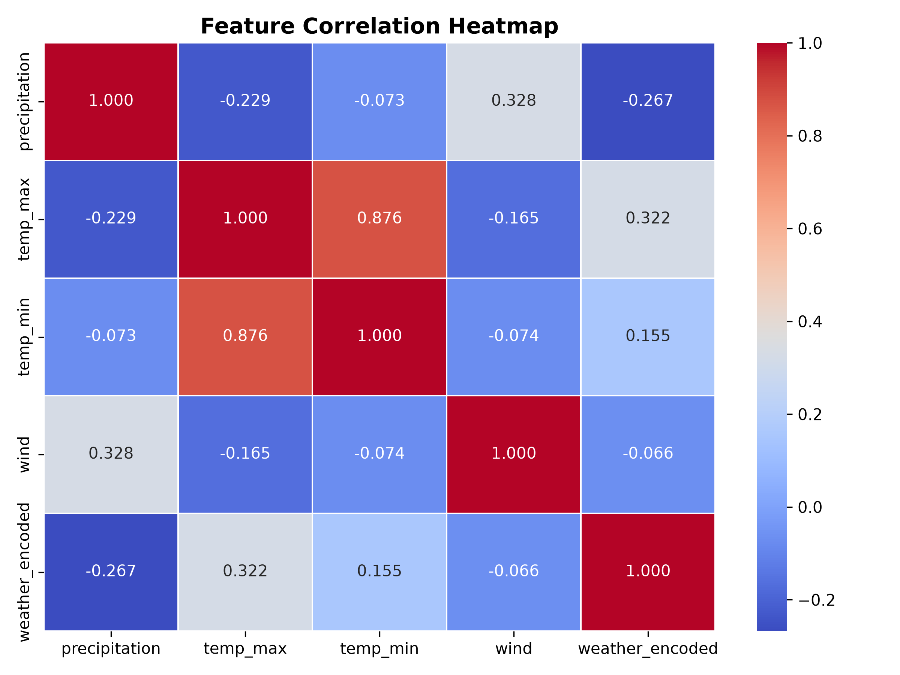
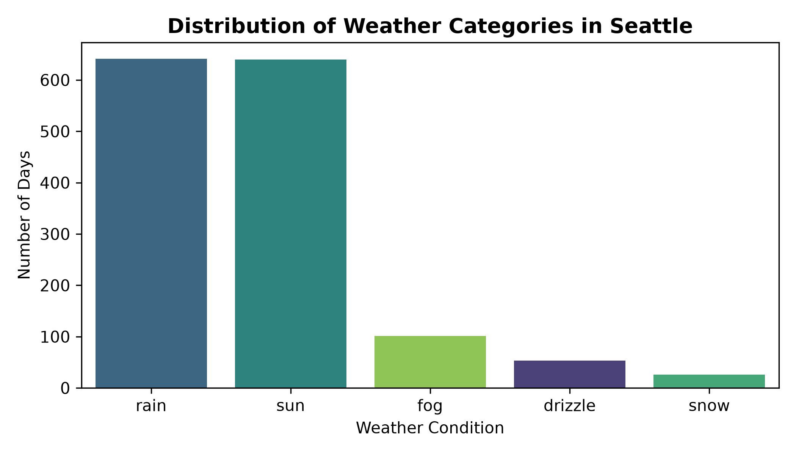
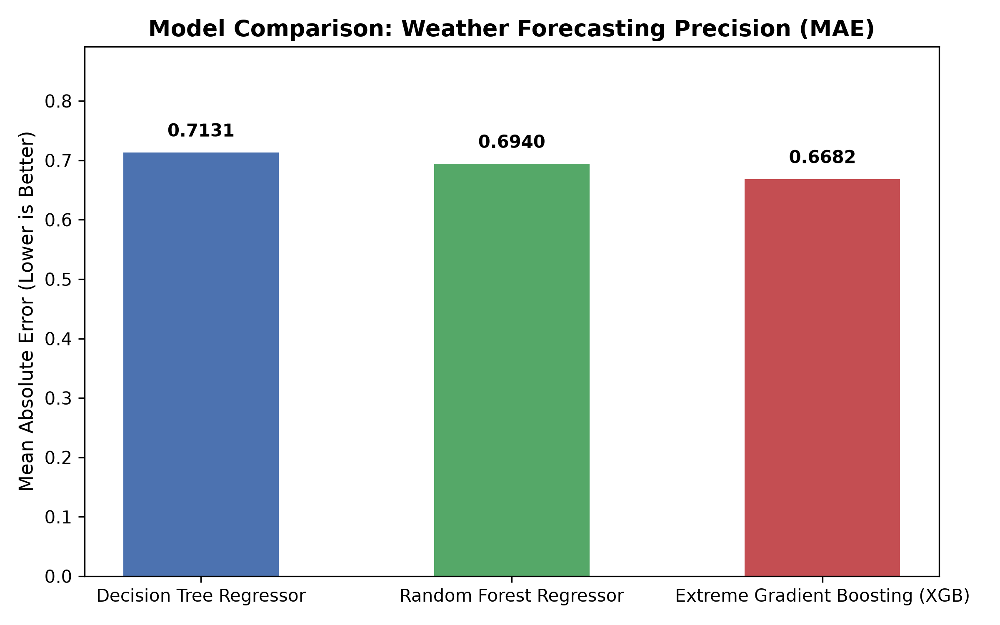
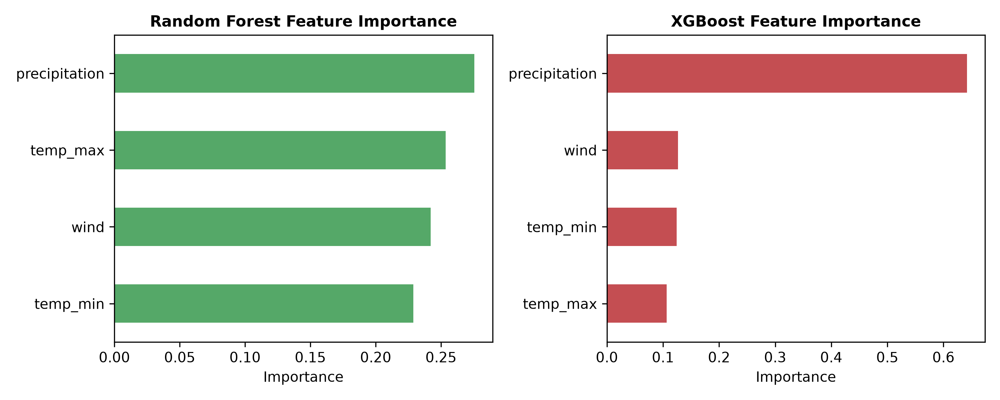

# 🌦️ Weather Forecasting Using Machine Learning

[](https://www.python.org/)
[](https://scikit-learn.org/)
[](https://xgboost.ai/)
[](https://pandas.pydata.org/)
[](LICENSE)
[](https://github.com/12636373)

An end-to-end Machine Learning project predicting daily weather conditions based on meteorological measurements (precipitation, temperature extremes, and wind speed) using **Decision Tree**, **Random Forest**, and **Extreme Gradient Boosting (XGBoost)** models. Includes model precision benchmarking, feature importance evaluation, and an interactive CLI weather forecaster.

---

## 📌 Table of Contents
- [Project Overview](#-project-overview)
- [Dataset Architecture](#-dataset-architecture)
- [Machine Learning Workflow](#-machine-learning-workflow)
- [Benchmark Results](#-benchmark-results)
- [Visualizations & Insights](#-visualizations--insights)
- [Interactive Weather Predictor](#-interactive-weather-predictor)
- [Installation & Quick Start](#-installation--quick-start)
- [Project Structure](#-project-structure)
- [Author & License](#-author--license)

---

## 🌟 Project Overview
Accurate weather forecasting plays a vital role in agriculture, logistics, aviation, and emergency preparedness. This project investigates whether tree-based ensemble models can effectively capture non-linear relationships among atmospheric parameters to forecast categorical weather phenomena.

### Key Highlights
- **Comparative Benchmarking**: Direct performance comparison across Decision Tree, Random Forest, and XGBoost.
- **Precision Metric**: Evaluated using Mean Absolute Error (MAE), Root Mean Squared Error (RMSE), and $R^2$ score.
- **Interactive Predictor (`predict.py`)**: Instant forecasting via command-line arguments or an interactive terminal prompt.
- **Reproducible Pipeline (`run_project.py`)**: Single-script execution covering data ingestion, training, evaluation, and chart generation.

---

## 📊 Dataset Architecture
The project utilizes historical weather observations from the **Seattle Weather Dataset** (`seattle-weather.csv`), comprising **1,461 daily records**.

| Feature | Type | Description | Unit / Range |
|:---|:---:|:---|:---:|
| `date` | String / Datetime | Observation date | 2012-01-01 to 2015-12-31 |
| `precipitation` | Float | Measured precipitation amount | 0.0 – 55.9 mm |
| `temp_max` | Float | Maximum recorded temperature | -1.6 – 35.6 °C |
| `temp_min` | Float | Minimum recorded temperature | -7.1 – 18.3 °C |
| `wind` | Float | Average wind velocity | 0.4 – 9.5 m/s |
| **`weather`** | Categorical | Target weather label | `drizzle`, `fog`, `rain`, `snow`, `sun` |

### Target Encoding
| Weather Condition | Encoded Class Index | Distribution Count |
|:---|:---:|:---:|
| **drizzle** | 0 | 53 |
| **fog** | 1 | 101 |
| **rain** | 2 | 641 |
| **snow** | 3 | 26 |
| **sun** | 4 | 640 |

---

## 🧠 Machine Learning Workflow
1. **Preprocessing & Encoding**:
   - Categorical targets are mapped using `LabelEncoder`.
   - Feature matrix $X = [\text{precipitation}, \text{temp\_max}, \text{temp\_min}, \text{wind}]$.
   - Target vector $y = \text{weather\_encoded}$.
   - Data split into **75% Train (1,095 samples)** and **25% Test (366 samples)** (`random_state=0`).
2. **Models Implemented**:
   - **Decision Tree Regressor** (`random_state=1`): Serves as a deterministic non-linear baseline.
   - **Random Forest Regressor** (`random_state=1`): Bagging ensemble reducing variance across decision boundaries.
   - **XGBoost Regressor** (`n_estimators=100`, `learning_rate=0.04`, `random_state=1`): Gradient boosted trees sequentially optimizing residual errors.

---

## 📈 Benchmark Results

| Model | MAE (Lower is Better) | RMSE | $R^2$ Score | Rank |
|:---|:---:|:---:|:---:|:---:|
| **Extreme Gradient Boosting (XGBoost)** | **0.6682** | **1.0614** | **0.2076** | 🥇 **Best Performance** |
| **Random Forest Regressor** | **0.6940** | 1.1375 | 0.0898 | 🥈 2nd Place |
| **Decision Tree Regressor** | **0.7131** | 1.4941 | -0.5702 | 🥉 3rd Place |

> **Conclusion**: XGBoost achieved the lowest Mean Absolute Error ($0.6682$), representing a ~6.3% precision improvement over the single Decision Tree baseline.

---

## 🖼️ Visualizations & Insights

### 1. Feature Correlation Heatmap
Precipitation shows the strongest negative correlation with maximum temperature and a positive correlation with wind speed.


### 2. Weather Category Distribution
The dataset exhibits significant frequency of `rain` and `sun`, with fewer occurrences of `snow`, `drizzle`, and `fog`.


### 3. Model Error Comparison (MAE)
Comparison of Mean Absolute Error across the evaluated algorithms on the unseen test set:


### 4. Feature Importance
Both Random Forest and XGBoost indicate that **precipitation** and **maximum temperature** are the dominant predictors for weather classification.


---

## 🔮 Interactive Weather Predictor
An interactive CLI tool is included to forecast weather from user-specified weather variables.

### Option A: Command-Line Flags
```bash
python predict.py --precipitation 8.5 --temp_max 14.0 --temp_min 7.5 --wind 4.2
```

**Output**:
```text
==================================================
WEATHER FORECAST PREDICTION RESULTS
==================================================
Inputs:
  * Precipitation:     8.5 mm
  * Max Temperature:   14.0 °C
  * Min Temperature:   7.5 °C
  * Wind Speed:        4.2 m/s
--------------------------------------------------
Predictions:
  * Decision Tree:     [Rain] (Score: 2.00)
  * Random Forest:     [Rain] (Score: 2.00)
  * XGBoost (Best):    [Rain] (Score: 2.02)
==================================================
Consensus Forecast: [Rain]
==================================================
```

### Option B: Interactive Terminal Prompt
```bash
python predict.py --interactive
```

---

## 🚀 Installation & Quick Start

### 1. Clone the Repository
```bash
git clone https://github.com/12636373/Weather-Forecasting-Using-ML.git
cd Weather-Forecasting-Using-ML
```

### 2. Set Up Virtual Environment (Recommended)
```bash
python -m venv venv
# Windows:
venv\Scripts\activate
# Linux/macOS:
source venv/bin/activate
```

### 3. Install Dependencies
```bash
pip install -r requirements.txt
```

### 4. Run the Full Benchmark Pipeline
```bash
python run_project.py
```

### 5. Open and Explore the Jupyter Notebook
```bash
jupyter notebook weather-prediction-model-precision-comparison.ipynb
```

---

## 📁 Project Structure
```text
Weather-Forecasting-Using-ML/
│
├── assets/                                     # Generated visual plots for documentation
│   ├── correlation_heatmap.png
│   ├── feature_importance.png
│   ├── model_comparison.png
│   └── weather_distribution.png
│
├── weather-prediction-model-precision-comparison.ipynb  # Main Jupyter notebook
├── run_project.py                              # Automated pipeline runner & evaluator
├── predict.py                                  # Interactive CLI weather forecasting tool
├── seattle-weather.csv                         # Historical meteorological dataset
├── requirements.txt                            # Python dependencies
├── .gitignore                                  # Git exclusion rules
├── LICENSE                                     # MIT License
└── README.md                                   # Project documentation
```

---

## 👤 Author
**Harish**
- GitHub: [@12636373](https://github.com/12636373)
- Repository: [Weather-Forecasting-Using-ML](https://github.com/12636373/Weather-Forecasting-Using-ML)

---

## 📜 License
This project is open-source and distributed under the [MIT License](LICENSE).
